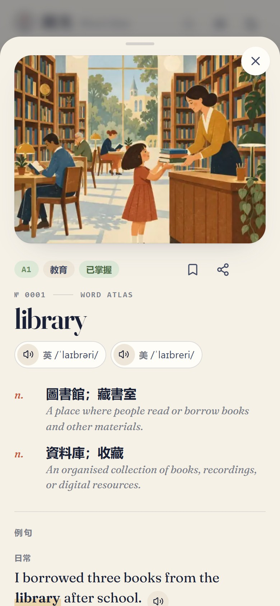

<div align="center">

<a href="https://zeroasuka.github.io/word-atlas/"></a>

# 詞光 · Word Atlas

**把單詞變成畫面，讓複習有跡可循。**

7,298 個雅思詞條 · 原創插畫 · 英美髮音 · FSRS 間隔複習

[**立即體驗 ↗**](https://zeroasuka.github.io/word-atlas/)　 /　 [產品導覽](docs/assets/launch.mp4)　 /　 [下載詞庫](data/)　 /　 [English](README.en.md)

[](LICENSE)
[](CONTENT_LICENSE.md)

<br>

**詞光 iOS App 已在 App Store 上架，免費下載：[App Store · 搜尋「詞光」](https://apps.apple.com/app/id6827459612)**

[](https://x.com/yangleiocx3)

</div>

---

詞光是一款以插畫和語境為核心的雅思背詞應用。看畫面理解詞義，聽發音建立聯絡，再用主動回憶和間隔複習鞏固記憶。無需賬號，學習進度儲存在自己的裝置上。

> **版本說明**：這個倉庫提供詞光的開源基礎版及配套資料集。線上網站獨立迭代，功能與倉庫可能不同；倉庫裡的程式碼和內容分別遵循下方的 MIT / CC BY 4.0 授權。

[產品預覽](#產品預覽) · [學習方式](#學習方式) · [本地執行](#本地執行) · [開放資料](#開放資料) · [參與貢獻](#參與貢獻)

## 產品預覽

### 一本可以聽、可以練的單詞圖鑑


<table>
<tr>
<td width="50%"></td>
<td width="50%"></td>
</tr>
<tr><td align="center">每日計劃，把注意力放在今天</td><td align="center">插畫、詞義、發音，在一張詞卡里</td></tr>
</table>

<sub>以上為倉庫開源版的實際介面。頁首為品牌概念插畫。</sub>

### 學過的詞，匯成自己的星圖


19 個話題組成詞彙星圖。拖動旋轉、滾動縮放，點選星星開啟詞卡；學習狀態用不同亮度呈現。採用 WebGL2 渲染，不支援的裝置提供降級顯示。

<details>
<summary><b>看產品導覽影片</b></summary>

<a href="docs/assets/launch.mp4"></a>

[播放產品導覽影片](docs/assets/launch.mp4)

</details>

## 學習方式

| 環節 | 你會做什麼 |
| :--- | :--- |
| **看見** | 每個詞配一幅插畫、中英釋義、兩條原創例句，以及搭配、詞族和用法提示。 |
| **聽見** | 切換英音、美音，聽日常例句朗讀；部分詞條另含第二條例句錄音。 |
| **想起** | 看義選詞、看圖補句、聽音辨詞、拼寫，逐步練習主動回憶。 |
| **複習** | FSRS 根據學習記錄安排複習，目標記憶率可調。只有首次作答計入正確率。 |
| **積累** | 星圖展示學習進度；打字練習獨立統計；支援匯出和恢復本地進度。 |

**本地優先。** 無需註冊；看過的詞條與媒體可快取供離線使用。換裝置前，請先匯出進度備份。

<details>
<summary><b>聽發音、例句與環境聲樣本</b></summary>


拿 *abandon* 舉例，點開就能聽（線上播放）：

| | |
|---|---|
| 🇬🇧 英音 | [abandon /əˈbændən/](https://zeroasuka.github.io/word-atlas/atlas/audio/uk/abandon.mp3) |
| 🇺🇸 美音 | [abandon /əˈbændən/](https://zeroasuka.github.io/word-atlas/atlas/audio/us/abandon.mp3) |
| 📖 例句朗讀 | [We had to abandon our car in the snow.](https://zeroasuka.github.io/word-atlas/atlas/audio/ex/abandon.mp3) |

全部 7,298 個詞都有英音、美音和例句朗讀，還有 1,011 個重點詞的第二條例句也配了朗讀。

### 環境聲與互動聲音

| | |
|---|---|
| 🎙 **開屏配音** | [「歡迎開啟雅思大門」](https://zeroasuka.github.io/word-atlas/sfx/splash-voice.mp3)：星塵匯聚成“詞光”，大門開啟 |
| 🌌 **星圖配音** | [「這是你的詞彙星圖。每學會一個詞，就點亮一顆星。」](https://zeroasuka.github.io/word-atlas/sfx/voice-galaxy-hello.mp3) |
| 🎵 **星空音樂** | [一段可無縫迴圈的原創配樂](https://zeroasuka.github.io/word-atlas/sfx/amb-stars.mp3)，預設陪你背詞 |
| 🌧 **6 段環境聲** | [雨天圖書館](https://zeroasuka.github.io/word-atlas/sfx/amb-rain.mp3) · [清晨海岸](https://zeroasuka.github.io/word-atlas/sfx/amb-sea.mp3) · [林間早晨](https://zeroasuka.github.io/word-atlas/sfx/amb-forest.mp3) · [夜晚壁爐](https://zeroasuka.github.io/word-atlas/sfx/amb-fire.mp3) · [遠航船艙](https://zeroasuka.github.io/word-atlas/sfx/amb-voyage.mp3) · [安靜咖啡館](https://zeroasuka.github.io/word-atlas/sfx/amb-cafe.mp3) |
| ✨ **介面音效** | 答對、答錯、翻卡、打字、連勝、點亮星星……每個操作都有自己的聲音；讀單詞時背景音會自動壓低 |

全部素材都在倉庫裡：插畫在 `public/atlas/img/`，錄音在 `public/atlas/audio/`，這兩類按 CC BY 4.0 開放；介面聲音和配樂在 `public/sfx/`，隨應用一起提供。


</details>

## 本地執行

需要 **Node.js 20+** 和 npm。倉庫含完整圖片與錄音，首次下載可能較久。

```bash
git clone --depth 1 https://github.com/zeroasuka/word-atlas.git
cd word-atlas
npm ci
npm run dev
```

開啟 **http://localhost:5188**。

```bash
npm test             # 單元測試
npm run check:atlas  # 詞庫結構與媒體校驗
npm run build        # 構建到 dist/
```

子路徑部署：`ATLAS_BASE=/word-atlas/ npm run build`。完整說明見 [部署文件](docs/deployment.md)。

**技術棧**：React 19 · TypeScript · Vite · ts-fsrs · WebGL2

## 開放資料

不僅可以直接使用應用，也可以把詞庫用於自己的學習工具、Anki 牌組或研究專案。

| 資源 | 開源版內容 | 入口 |
| :--- | :--- | :--- |
| 詞條 | **7,298** 條，CEFR A1–C2、19 個話題 | [JSON](data/word-atlas.json) · [CSV](data/word-atlas.csv) |
| 例句 | **14,596** 條，日常與雅思語境，附中文翻譯 | [欄位說明](docs/dataset.md) |
| 插畫 | **7,298** 幅，512 px WebP，另有縮圖 | [圖片目錄](public/atlas/img/) |
| 錄音 | **22,905** 段，英音、美音與例句朗讀 | [音訊目錄](public/atlas/audio/) |

```python
import json
from pathlib import Path

words = json.loads(Path("data/word-atlas.json").read_text(encoding="utf-8"))
b2_environment = [w for w in words if w["cefr"] == "B2" and w["topic"] == "environment"]
```

<details>
<summary><b>檢視一條詞條的資料結構</b></summary>

```json
{
  "id": "principle",
  "w": "principle",
  "uk": "/ˈprɪnsəpəl/",
  "us": "/ˈprɪnsəpəl/",
  "senses": [{ "pos": "n.", "zh": "原則；行為準則", "en": "A belief or rule that guides decisions and behaviour." }],
  "ex": [
    { "en": "I refused the extra money as a matter of principle.", "zh": "出於原則，我拒絕了那筆額外的錢。" },
    { "en": "The principle of equal opportunity should guide policies designed to improve access to higher education.", "zh": "…" }
  ],
  "col": ["in principle｜原則上", "basic principle｜基本原則"],
  "fam": ["principled (adj.)"],
  "tip": "principle 是原則；principal 是校長、主要的。",
  "cefr": "B2",
  "topic": "thinking"
}
```

</details>

### 內容來源與侷限

釋義、例句、插畫和錄音為本專案生成：文字與插畫使用生成式 AI，語音使用 ElevenLabs。內容經過自動結構與一致性校驗，**尚未逐條人工審校**，可能出現釋義、例句、插畫或發音錯誤。它不是官方雅思詞表，也不承諾提分。

[內容生成流程](docs/pipeline.md) · [記憶模型](docs/learning-model.md) · [生成指令碼](scripts/atlas/)

## 參與貢獻

發現問題時，請附上**詞條 ID、復現步驟和預期結果**。內容糾錯如有詞典或其他可靠依據，也請一併提供。

- [報告問題](https://github.com/zeroasuka/word-atlas/issues/new/choose)：詞條糾錯、介面問題或使用建議。
- [貢獻指南](CONTRIBUTING.md)：資料同步、程式碼規範和提交前檢查。
- [安全政策](SECURITY.md)：安全問題的反饋方式。

## 授權

| 範圍 | 許可 |
| :--- | :--- |
| 應用程式碼 | [MIT](LICENSE) |
| 詞庫文本、插畫與詞條錄音 | [CC BY 4.0](CONTENT_LICENSE.md)，署名 Word Atlas contributors（詞光） |
| 第三方依賴與字型 | 遵循各自許可，詳見相應檔案 |

---

由 [@designfuchen](https://github.com/designfuchen) 製作。產品進展與製作過程見 [X · @yangleiocx3](https://x.com/yangleiocx3)。

如果詞光對你有用，歡迎 Star，或把它分享給正在學英語的朋友。
